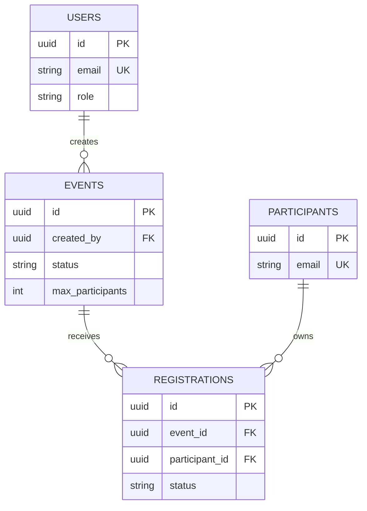

# EventHub — Gestion d’événements & inscriptions

Application PERN : Express/Node.js, PostgreSQL et React/Vite. Elle permet à un administrateur ou membre staff de gérer les événements, participants et inscriptions.

## Conception



Contraintes : UUID (`pgcrypto`), e-mails uniques, capacité strictement positive, statuts contrôlés, unicité `(event_id, participant_id)`, intégrité FK. Index : `events(status, event_date)`, recherche participant normalisée et inscriptions par événement/statut. Un trigger PostgreSQL annule automatiquement les inscriptions actives lorsque l’événement devient `cancelled`.

Le document complet (tables, relations, contraintes, index et répartition du seed) est disponible dans [backend/db/ERD.md](backend/db/ERD.md).

## Installation

Prérequis : Node.js 20+ et PostgreSQL 14+.

```powershell
createdb eventhub
psql -d eventhub -f backend/db/schema.sql
psql -d eventhub -f backend/db/seed.sql
Copy-Item backend/.env.example backend/.env
```

Renseigner `DATABASE_URL` et `JWT_SECRET` dans `backend/.env`, puis lancer deux terminaux :

```powershell
cd backend; npm install; npm run dev
cd frontend; npm install; npm run dev
```

Le client est disponible sur `http://localhost:5173` et l’API sur `http://localhost:4000`.

## Docker (API + PostgreSQL)

Depuis la racine du projet, Docker initialise PostgreSQL avec le schéma et les données de démonstration au premier démarrage :

```powershell
docker compose up --build
```

L’API sera disponible sur `http://localhost:4000/api/health`. Pour repartir avec une base vide : `docker compose down -v` puis relancer la commande.

Comptes de démonstration : `admin@eventhub.test` ou `staff@eventhub.test`, mot de passe `Password123!`.

## API

Toutes les routes métier nécessitent `Authorization: Bearer <JWT>`.

- `POST /api/auth/login`, `GET /api/auth/me`
- `GET|POST /api/events`, `GET|PUT /api/events/:id`, `PATCH /api/events/:id/status`
- `GET|POST /api/participants`, `PUT|DELETE /api/participants/:id`
- `GET|POST /api/registrations`, `PATCH /api/registrations/:id/status`
- `GET /api/dashboard`
- `GET|POST /api/users`, `PUT /api/users/:id` (admin)

L’API applique Zod aux entrées et répond avec des erreurs explicites 400, 401, 403, 404, 409 ou 500. La création d’inscription est transactionnelle avec verrouillage de l’événement : les doublons, événements non publiés et capacités atteintes sont rejetés sans condition de course.
