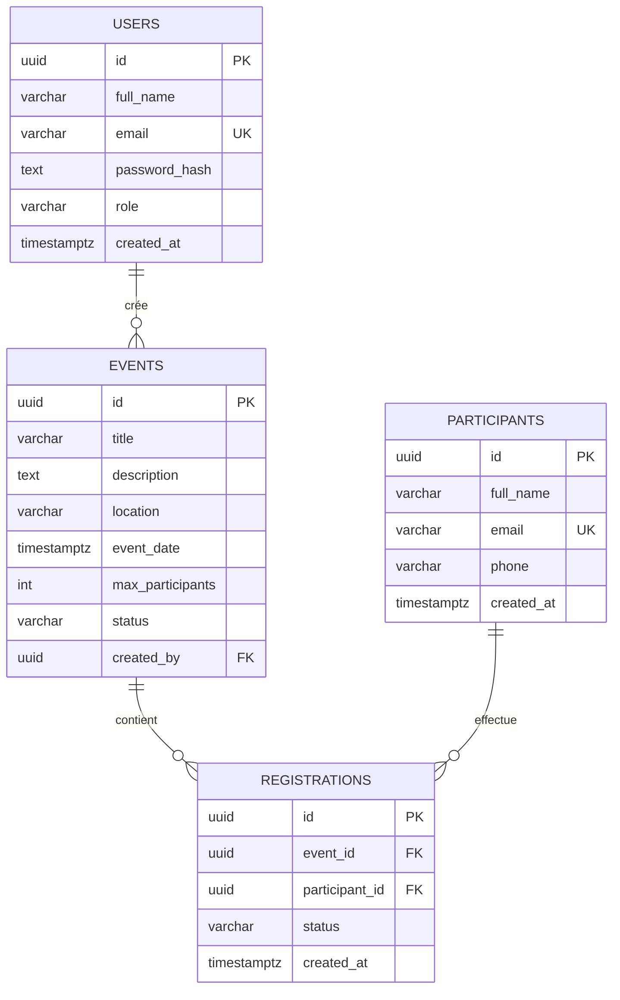

# Conception de la base de données — EventHub

| Table | Clé primaire | Relations et contraintes |
| --- | --- | --- |
| `users` | `id` UUID | `email` unique, rôle limité à `admin` ou `staff`. |
| `events` | `id` UUID | `created_by` → `users.id`; capacité positive; statut `draft`, `published` ou `cancelled`. |
| `participants` | `id` UUID | `email` unique et obligatoire. |
| `registrations` | `id` UUID | `event_id` → `events.id`, `participant_id` → `participants.id`, unicité `(event_id, participant_id)`. |

## Intégrité et performances

- Les clés étrangères des inscriptions utilisent `ON DELETE CASCADE`; un participant ou événement supprimé retire ses inscriptions.
- La suppression d’un utilisateur créateur est restreinte (`ON DELETE RESTRICT`).
- Le trigger `event_cancellation` transforme les inscriptions actives en `cancelled` lorsqu’un événement est annulé.
- Index : `events(status, event_date)`, `participants(lower(full_name), lower(email))`, `registrations(event_id, status)` et `registrations(created_at)`.

## Données de démonstration

| Élément | Quantité | Détail |
| --- | ---: | --- |
| Utilisateurs | 2 | 1 admin et 1 staff |
| Événements | 5 | 3 publiés, 1 brouillon, 1 annulé |
| Participants | 10 | emails uniques |
| Inscriptions | 20 | 16 `confirmed`, 2 `pending`, 2 `cancelled` |
